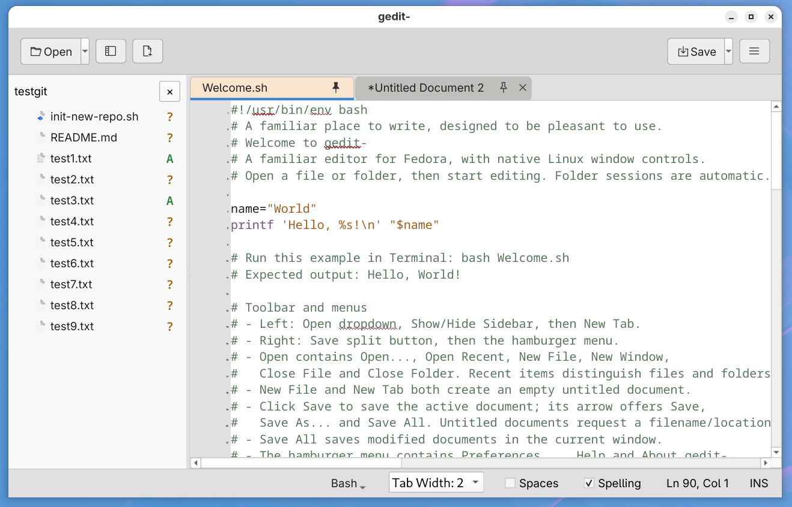

# gedit-



A simple text editor inspired by GNOME gedit that is pleasant to use.

Built for Fedora with Qt 6 Widgets and QScintilla, gedit- follows the layout and editing behavior of [medit-](https://github.com/greenfinch628/medit-) on macOS. The aim is a familiar experience when switching computers, with native window controls, file dialogs and platform shortcuts. This is an independent development project, not an official GNOME or gedit release.

## Features

- Open files and folders, browse recent items, and work in multiple windows.
- Save, Save As and Save All, with detected text encoding retained for existing files and UTF-8 for new files and Save As.
- Select rectangular blocks with **Alt+drag**, then copy, cut, paste or type across their rows. No plugin is required.
- Restore untitled drafts, unsaved edits, tabs, pins, colors, cursor positions and folder sessions after restarting.
- Keep documents open and report an error if recovery cannot be written.
- Right-click a tab to rename its file. Naming an untitled document saves it in the sidebar folder; existing files are never overwritten.
- Compact movable tabs, a fixed pinned group, individual tab colors and configurable active/inactive colors.
- A folder sidebar with an invisible fixed column for read-only Git status badges.
- Find, Replace and Replace All, line numbers and a live line/column indicator.
- Configurable tab width and tabs or spaces, available from the bottom controls.
- Syntax highlighting enabled by default, with a fixed scheme and Bash, Markdown and Plain Text choices. Bash uses Xcode Default (Light) Swift colors mapped to Bash tokens.
- Optional English spell checking, correction suggestions and document-only Ignore. Ignoring a word never adds it to a dictionary.
- Independent interface and editor fonts, including system fonts, under Preferences.
- An editable, pinned Welcome script with a Hello World example and a Show Welcome on startup preference.

## Build and try

Choose **gedit-** in the application menu on Scopuli, or run from the source directory:

```sh
./run-prototype
```

The historical launcher filename is retained. Pass files or folders as arguments; later launches forward them to the running editor. Use **Open → New Window** for another window.

For a fresh checkout, install Python, the Qt runtime dependencies for your desktop, and Enchant with an English dictionary. Fedora uses `enchant2` and `hunspell-en-US`. Then:

```sh
python3 -m venv .venv
.venv/bin/pip install -r requirements.txt
.venv/bin/python install-launcher.py
./run-prototype
```

The installer adds a separate per-user gedit- launcher and icon. It does not replace the legacy gedit installation, launcher, preferences or recovery data, and it does not change file associations.

## Rectangular selection and column copy/cut/paste

Hold **Alt** and drag with the **left mouse button** across the text to select a rectangle.

- **Ctrl+C** copies the selected columns, with one clipboard row per selected line.
- **Ctrl+X** cuts the selected columns while preserving document line breaks.
- **Ctrl+V** pastes across the selected rows. One pasted line repeats on every row; multiline text must contain one line per selected row.
- Typing replaces the selection on each row. Short and blank rows are padded when inserting beyond their ends.
- **Ctrl+Z** undoes a block edit in one step.
- **Esc** or a normal left click leaves rectangular selection.

Copy, Cut and Paste are also available from the context menu. Without a rectangle, paste behaves normally. Use a monospace font for predictable column alignment. Some desktop configurations reserve Alt-drag for moving windows; adjust that desktop shortcut if it intercepts the gesture.

## Directory browser and workspaces

Use **Open → Workspace** to choose a folder. Expand folders with their disclosure arrows and double-click a file to open it. The toolbar sidebar button, **F9**, and the sidebar × control show or hide the browser without closing documents. Resize it using the divider.

Folder sessions remember tabs, order, pins, colors, tab settings, active document, cursor/selection, scrolling and sidebar state. Switching folders preserves the outgoing session; **Close Folder** returns to documents opened without a folder. Each window has independent recovery. Session files are kept in application data, not in the folder being edited. Directory symlinks are not expanded recursively.

Git badges occupy a persistent column at the far right: **M** modified, **A** added, **D** deleted, **R** renamed, **C** copied, **T** type changed, **?** untracked and **!** conflict. Folder badges summarize changes beneath them. Preferences → Editing → Show Git status in sidebar controls visibility and scanning. Git status describes files on disk and never stages, commits or writes the index.

## Preferences, colors and Welcome

Preferences contains Fonts, Editing, Appearance and Spelling. Bottom controls change the current document's language, tab width, spaces and spelling; Editing preferences set defaults for new documents. Choosing spaces affects new Tab insertions, not existing text.

Right-click a tab for **Tab Color…** or **Use Default Color**. Appearance sets the default active/inactive colors. The color selector offers a grid of lighter-to-stronger shades and a **Custom color…** button. Saved tab colors survive recovery.

Welcome opens pinned by default. Unpinning it closes the tab and unchecks **Preferences → Appearance → Show Welcome on startup**. Unchecking that preference also removes Welcome and prevents session recovery from reopening it. Welcome remains editable; dismissed edits are retained in closed-tab recovery. Other documents are unaffected.

A single left-click on an underlined misspelling offers corrections and **× Ignore**. Ignore belongs only to that document, including its recovered session. Spell checking skips shell commands and Markdown code fences; Bash comments and prose can be checked.

## Recovery and closing

By default, closing or quitting preserves unsaved text without asking to save. Enable the optional closing prompt for **Save / Keep Recovery / Cancel**. Explicitly closed tabs are archived; reopen them through **Open → Restore Closed Tab…** or **Ctrl+Shift+T**.

Recovery runs after a 250 ms debounce and before closing or switching folders. Writes use private permissions, atomic replacement, fsync and previous snapshots. Failed recovery prevents closure. The final fraction of a second before abrupt power loss may precede a snapshot. Clean saved tabs reload disk contents; recovered edits remain unsaved, and saving warns if the original changed externally.

Settings, recovery and closed-tab copies are local, unencrypted text under `~/.local/share/Greenfinch628/gedit-qt-prototype/`. The development identity is retained for continuity. Recovery does not save changes to original documents, and archives are not automatically deleted.

UTF-8, UTF-16/32 BOMs, plausible unmarked UTF-16 and Windows-1252 are supported. Existing encoding, BOM and newline contents are retained; Save As uses UTF-8. Ambiguous encoding detection can differ from macOS. Binary files are not supported.

## Validation

```sh
QT_QPA_PLATFORM=offscreen .venv/bin/python check_prototype.py
QT_QPA_PLATFORM=offscreen .venv/bin/python check_enhancements.py
QT_QPA_PLATFORM=offscreen .venv/bin/python check_launch.py
QT_QPA_PLATFORM=offscreen .venv/bin/python check_welcome.py
QT_QPA_PLATFORM=offscreen .venv/bin/python check_rename.py
```

Checks cover actual Alt-drag selection, column copy/cut/paste and undo, short-row padding, saving, recovery failures, folder sessions, Git status, preferences, later launches and Welcome behavior. Complex Unicode column geometry still benefits from hands-on testing.

Use `--data-dir /tmp/editor-review` for isolated settings and recovery. `--preview /tmp/editor.png` captures the application with temporary data and exits; `--capture /tmp/editor.png` keeps it running. See [REVIEW.md](REVIEW.md) and [REFERENCE.md](REFERENCE.md) for development notes.

## Source and dependencies

This is an independent Qt implementation, rather than a patch to upstream gedit. Runtime dependencies are pinned in [requirements.txt](requirements.txt); their respective license terms apply. Build output, local settings, recovery fixtures and backups are excluded from Git.

## Repositories

Source: [GitHub](https://github.com/greenfinch628/gedit-) and [Scopuli Gitea](http://scopuli:3000/scopuli/gedit-).

Related projects: [medit- for macOS](https://github.com/greenfinch628/medit-) and [gedit-legacy](https://github.com/greenfinch628/gedit-legacy). The legacy application remains separate and preserved.

## Binary packages

The current Qt editor runs from source on Fedora. RPM and Ubuntu DEB packages have not yet been produced or validated for this implementation. Legacy packages do not contain this editor; Ubuntu compatibility still requires a packaged build and testing.
